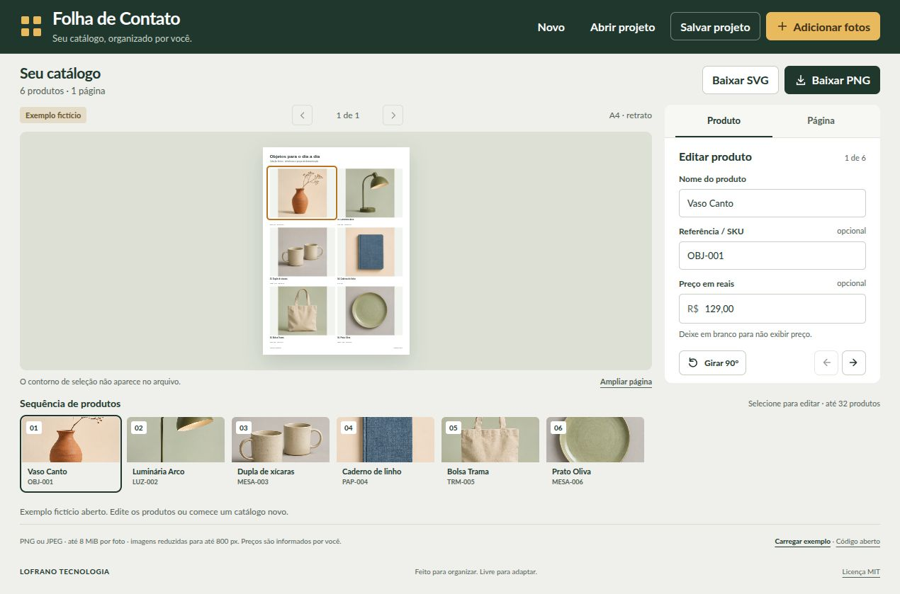

# Folha de Contato

Transforme fotos de produtos em páginas de catálogo. Adicione nome, referência e preço opcional, organize a sequência e confira a folha enquanto edita. A Folha de Contato funciona no navegador, sem conta ou servidor de aplicação.

[Link da demonstração no GitHub Pages](https://martinlofranodeoliveira.github.io/folha-de-contato/) · [LOFRANO TECNOLOGIA](https://lofranotecnologia.com.br) · [Contrato do formato e das operações](SPEC.md)



## Monte seu catálogo

1. Explore o exemplo fictício ou escolha **Novo** para começar vazio.
2. Clique em **Adicionar fotos** e selecione arquivos PNG ou JPEG. Cada foto vira um produto.
3. Selecione um produto na sequência e informe seu nome, referência/SKU e preço, se quiser. Use os botões para mover o produto ou girar sua foto em 90°.
4. Na aba **Página**, ajuste título, subtítulo, formato A4/Carta, orientação, linhas, colunas e enquadramento. **Foto inteira** preserva todo o conteúdo; **Preencher o quadro** pode recortar as bordas.
5. Navegue pelas páginas, use **Ampliar página** para conferir os detalhes e baixe a página desejada e use **Salvar projeto** para continuar a edição depois.

As fotos e os dados ficam na memória da aba. **Não há salvamento automático.** Fechar ou recarregar a página pode perder alterações que ainda não foram baixadas como projeto JSON.

O nome pode ficar vazio; nesse caso, a folha usa o nome do arquivo. Referências repetidas são permitidas. Nomes e detalhes longos podem ser abreviados ou recortados na folha; o conteúdo completo continua no projeto.

## Preços informados por você

Deixe o campo vazio para omitir o preço. Use valores como `129,90`, `129` ou `1.234,56`, sem o prefixo `R$`. O ponto serve somente para agrupar milhares; os centavos são representados com vírgula. Um preço zero é diferente de um preço ausente.

O modelo guarda centavos inteiros, sem calcular dinheiro por ponto flutuante. Um preço inválido continua sinalizado para correção e impede salvar ou exportar até ser resolvido. O aplicativo **não consulta, valida ou atualiza preços comerciais**. Não há integração de estoque, checkout ou comércio eletrônico.

## Arquivos que você pode baixar

| Ação | Conteúdo |
| --- | --- |
| **Baixar PNG** | Imagem raster da página atual, com fotos e dados visíveis. |
| **Baixar SVG** | Página atual em SVG, com os PNGs dos produtos embutidos. Não depende dos arquivos originais das fotos. |
| **Salvar projeto** | JSON completo com todas as páginas, configurações, produtos e fotos normalizadas, para reabrir e editar. |

Para continuar em outro momento ou navegador, use **Abrir projeto** e escolha o JSON salvo. A importação confere o documento e decodifica suas imagens antes de substituir o catálogo aberto. Uma falha de importação preserva o projeto anterior. Adicionar um lote de fotos também é uma operação integral: uma foto inválida impede aplicar o lote.

SVG e PNG são exportados **uma página por vez**. O contorno de seleção da interface não aparece no arquivo. A4 usa 1191 × 1684 pixels e Carta usa 1224 × 1584, com dimensões trocadas em paisagem. Isso define a geometria da exportação; não é um fluxo de pré-impressão com CMYK, sangria ou calibração de cor.

## Imagens e limites

| Recurso | Limite do aplicativo |
| --- | --- |
| Produtos por projeto | 32 |
| Imagem original | PNG ou JPEG, até 8 MiB e 16 milhões de pixels |
| Imagem normalizada | PNG com lado maior de até 800 px, sem ampliar a original |
| PNG normalizado por produto | 2 MiB |
| Soma dos PNGs normalizados | 16 MiB e 16 milhões de pixels |
| Projeto JSON de entrada | 24 MiB, UTF-8 sem BOM |
| Grade por página | 1 a 5 colunas e 1 a 6 linhas |

O processamento usa a orientação informada pela imagem e redesenha os pixels em um PNG reduzido. O projeto guarda esse PNG e o nome do arquivo, **não o arquivo original em alta resolução**. Guarde os originais separadamente. SVGs, URLs externas e outros formatos não são aceitos como fotos de entrada.

Decodificação, conversão de cor, fontes de fallback do SVG e geração de PNG dependem do navegador. Os resultados não têm promessa de identidade visual ou binária entre navegadores. O navegador também pode impor limites menores que os do aplicativo.

## Executar e desenvolver

Para usar a demonstração, basta um navegador com JavaScript e suporte às APIs de imagens e canvas utilizadas. Node.js não faz parte da aplicação entregue ao navegador.

Para trabalhar com as fontes, use **Node.js 22 ou superior**, npm e **Python 3** disponível como `python3` para os testes XML independentes:

```bash
git clone https://github.com/martinlofranodeoliveira/folha-de-contato.git
cd folha-de-contato
npm ci --ignore-scripts
npm test
npm run build
npm run check
npm run dev
```

Abra [http://127.0.0.1:4178/](http://127.0.0.1:4178/). O servidor de desenvolvimento atende somente em loopback e serve a pasta **dist**, portanto execute o build antes de iniciá-lo. Após mudar as fontes, faça outro build e recarregue a página. Para escolher outra porta, por exemplo, use `npm run dev -- 4180`.

Não há dependências JavaScript externas de execução. `npm test` executa os testes Node, incluindo o parsing XML pelo Python. `npm run build` copia a aplicação e seus assets para `dist/` e gera um manifesto de hashes. `npm run check` confere a distribuição contra as fontes e o manifesto; esse comando não substitui uma revisão funcional ou visual no navegador.

## Estrutura para adaptar

- [src/model.mjs](src/model.mjs): documento imutável, validação, preços e alterações de produtos.
- [src/layout.mjs](src/layout.mjs): paginação e geometria de fotos e rótulos.
- [src/svg.mjs](src/svg.mjs): SVG próprio com textos escapados e fotos internas.
- [src/image-io.mjs](src/image-io.mjs): limites, decodificação, normalização e PNG.
- [src/operations.mjs](src/operations.mjs): fila de operações e proteção contra resultados antigos.
- [src/app.mjs](src/app.mjs): interação entre a interface e o modelo.

O [SPEC.md](SPEC.md) fixa os campos, limites e invariantes. Veja [CONTRIBUTING.md](CONTRIBUTING.md) para alterações e [SECURITY.md](SECURITY.md) para tratar arquivos e relatar problemas.

## Código aberto e demonstração

Código e documentação sob [licença MIT](LICENSE), por contribuidores da [LOFRANO TECNOLOGIA](https://lofranotecnologia.com.br). As fontes Lato são distribuídas separadamente sob SIL Open Font License 1.1; preserve seus avisos ao redistribuir. Consulte [THIRD_PARTY_NOTICES.md](THIRD_PARTY_NOTICES.md).

O exemplo contém seis produtos fictícios, com imagem sintética original, nomes, referências e preços inventados. Não representa uma loja ou oferta real. A origem e o prompt do asset estão em [assets/DEMO.md](assets/DEMO.md). As alterações desta versão estão em [CHANGELOG.md](CHANGELOG.md).
